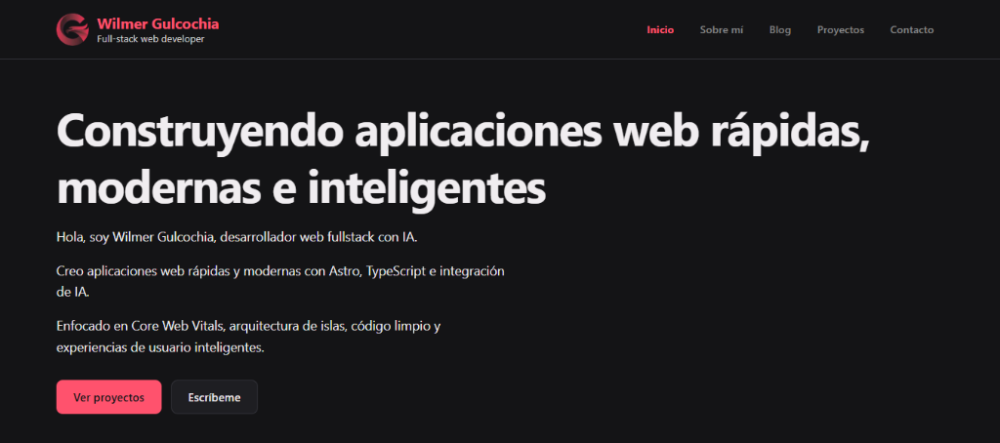

# 🚀 Portafolio Personal & Blog Técnico


[](LICENSE)

Plataforma personal y blog de ingeniería construida con **Astro 7.4**, **Tailwind CSS v4**, **Preact** y **TypeScript** bajo una arquitectura híbrida (**95% SSG en Edge CDN + 5% SSR Serverless**). Entrega cero JavaScript por defecto (_Zero-JS_), accesibilidad certificada **WCAG 2.1 AA** y navegación continua con **View Transitions**.

🌐 **Demo en producción:** [portafolio-blog-seven.vercel.app](https://portafolio-blog-seven.vercel.app)

[](https://portafolio-blog-seven.vercel.app)

---

## ✨ Características Principales

- **Portafolio y Trayectoria:** Catálogo curado de proyectos con enlaces directos a demos y código fuente, junto con perfil profesional, credenciales y CV descargable.
- **Blog Técnico con Contratos de Datos:** 10 artículos en Markdown y MDX validados en tiempo de compilación, con paginación, rutas por etiquetas, lectura estimada y artículos relacionados.
- **Búsqueda y Filtrado Instantáneo:** Isla interactiva que filtra todo el catálogo por etiqueta y texto en `< 1 ms` en memoria, sin recargas ni peticiones de red.
- **Contacto Resiliente en Servidor:** Formulario validado extremo a extremo en servidor con mejora progresiva (operativo incluso con JavaScript deshabilitado).
- **Accesibilidad Real y SEO Completo:** Modo Claro/Oscuro persistente sin parpadeos (*FOUC*), contraste certificado `5.86:1`, tipografía local de alta legibilidad, imágenes WebP, Sitemap, RSS 2.0 y OpenGraph.

---

## 🏆 Métricas en Producción (Lighthouse Mobile · Slow 4G)

| Performance | Accessibility | Best Practices | SEO | FCP / LCP | TBT | CLS | Carga Inicial |
|:---:|:---:|:---:|:---:|:---:|:---:|:---:|:---:|
| **100** | **100** | **100** | **100** | **1.4 s** | **20 ms** | **0** | **74.1 KiB** |

> Calidad automatizada: **`0` errores / `0` warnings** en `astro check` (41 archivos) · **`11/11` tests** aprobados en Vitest 5.

---

## 🛠️ Stack Tecnológico

| Área | Tecnologías |
| --- | --- |
| **Framework & Renderizado** | [Astro 7.4](https://astro.build) · Vite 8 · View Transitions (`<ClientRouter />`) · 26 rutas SSG + 1 ruta SSR |
| **Estilos & Tipografía** | Tailwind CSS v4 (`@tailwindcss/vite`) · Tokens Dark/Light · Fuente local _Atkinson_ (Astro Font API) |
| **Interactividad & Contenido** | Preact 11 (`@astrojs/preact`) · Content Collections (`glob`) + Zod · Markdown & MDX · Sharp (`<Image />`) |
| **Servidor & Despliegue** | Astro Actions + Zod · Adaptador dual `@astrojs/vercel` (producción) / `@astrojs/node` (local) |
| **SEO & Calidad** | `@astrojs/sitemap` · `@astrojs/rss` · `robots.txt.ts` · TypeScript 6 · Vitest 5 · Husky |

---

## ⚡ Inicio Rápido

**Prerrequisitos:** `Node.js >= 22.23.4` y `pnpm >= 9`. No requiere variables `.env` ni claves externas para ejecutarse en local.

```bash
git clone https://github.com/wigsdev/portafolio-blog.git
cd portafolio-blog
pnpm install
pnpm dev # Disponible en http://localhost:4321
```

| Comando | Propósito |
| --- | --- |
| `pnpm astro dev --background` | Inicia el servidor de desarrollo en segundo plano (`status`, `logs`, `stop`) |
| `pnpm check` | Auditoría estricta de tipos y plantillas (`astro check`) |
| `pnpm test` | Ejecuta las 4 suites de pruebas unitarias (Vitest) |
| `pnpm build` | Compila el proyecto (`dist/` en local o `.vercel/output/` en Vercel) |
| `pnpm preview` | Previsualiza localmente el build de producción (`@astrojs/node` standalone) |

---

## ☁️ Despliegue y Variables de Entorno

El proyecto detecta automáticamente el entorno en `astro.config.mjs`: en **Vercel** activa `@astrojs/vercel` (Edge CDN + Serverless Function Node 22 para `/contacto`) y en **local** utiliza `@astrojs/node` para mantener `pnpm preview` operativo sin dependencias externas.

| Variable | Requerida | Descripción |
| --- | :---: | --- |
| `VERCEL` | Automática (CI) | Activa el adaptador `@astrojs/vercel` durante el build en la nube |
| `VERCEL_PROJECT_PRODUCTION_URL` | Automática (CI) | Define el dominio canónico (`Astro.site`) para Sitemap, RSS y `robots.txt` |
| `SITE_URL` | Opcional | Sobrescribe manualmente la URL canónica en entornos personalizados |

---

## 📁 Estructura del Proyecto

```text
portafolio-blog/
├── docs/                              # Gobernanza, diseño y presentación ejecutiva
│   ├── backlog.md                     # Catálogo de 20 tareas en 5 Sprints
│   ├── diseno.md                      # Sistema de diseño, tokens y accesibilidad
│   ├── workflow.md                    # Git Flow, Conventional Commits y DoD
│   ├── diapositivas-presentacion.html # Presentación HTML5 interactiva (Product-First)
│   └── preview.png                    # Captura real de producción
├── public/                            # Favicons, íconos UI (SVG masks) y cv.pdf
├── src/
│   ├── actions/                       # Astro Actions de servidor (contacto)
│   ├── assets/                        # Imágenes optimizadas con Sharp y fuentes Atkinson
│   ├── components/                    # 16 componentes reutilizables (.astro y Preact .tsx)
│   ├── content/blog/                  # 10 artículos técnicos (9 .md + 1 .mdx)
│   ├── data/                          # Catálogos tipados de proyectos y credenciales
│   ├── layouts/                       # BaseLayout (View Transitions + tema) y BlogPost
│   ├── pages/                         # Rutas estáticas, dinámicas, paginadas, RSS, robots y /contacto SSR
│   ├── schemas/                       # Esquemas Zod compartidos
│   ├── styles/                        # Tailwind CSS v4 (@theme) y tokens Dark/Light
│   └── content.config.ts              # Content Layer API (glob + Zod)
├── tests/unit/                        # 4 suites Vitest (contact, seo, tokens, smoke)
├── astro.config.mjs                   # Adaptador dual, integraciones, Sharp y Font API
└── LICENSE                            # Licencia MIT
```

---

## 📋 Documentación y Versionado

- **Gestión Ágil:** 5 Sprints completados (`20/20` tareas) documentados en [**`docs/backlog.md`**](docs/backlog.md) y [**`docs/workflow.md`**](docs/workflow.md).
- **Historial de Cambios:** Versionado bajo [SemVer 2.0.0](https://semver.org/lang/es/) y [Keep a Changelog](https://keepachangelog.com/es-ES/1.1.0/) en [**`CHANGELOG.md`**](CHANGELOG.md).

---

## 👤 Autor

**Wilmer Gulcochía** — Full-Stack Web Developer

- **Sitio Web:** [portafolio-blog-seven.vercel.app](https://portafolio-blog-seven.vercel.app)
- **GitHub:** [@wigsdev](https://github.com/wigsdev)
- **LinkedIn:** [wigsdev](https://linkedin.com/in/wigsdev/)
- **Correo:** [karlwgs1989@gmail.com](mailto:karlwgs1989@gmail.com)

---

## 📄 Licencia

Distribuido bajo la licencia [**MIT**](LICENSE). © 2026 Wilmer Gulcochía.
