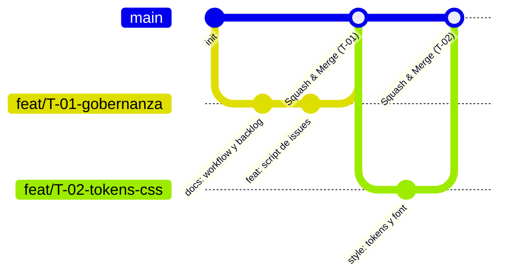

# 🔄 Workflow de Desarrollo y Gobernanza

Este documento establece el marco operativo y las convenciones de ingeniería de software para el desarrollo del proyecto **Portafolio + Blog** de **Wilmer Gulcochía (@wigsdev)**.

---

## 1. Modelo de Ramas (GitHub Flow Unipersonal)

Para garantizar un repositorio con estándar profesional, trazabilidad completa y preparación para evaluación técnica:



### 1.1 Reglas de Ramas
*   **Rama Principal (`main`):**
    *   Siempre estable, compilable y lista para despliegue en producción.
    *   No se realizan commits directos en `main`.
*   **Ramas de Funcionalidad (`feat/T-XX-nombre-tarea`):**
    *   Se crea una rama por cada tarea del Backlog ([docs/backlog.md](backlog.md)).
    *   Nomenclatura: `feat/T-01-gobernanza-y-documentacion`, `feat/T-02-tokens-css-y-fuentes`, etc.
*   **Ramas de Corrección (`fix/T-XX-nombre-bug`):**
    *   Para resolver incidencias o refactorizaciones detectadas en QA.
*   **Consolidación (Merge):**
    *   Integración a `main` mediante **Squash and Merge** o Pull Request vinculado al Issue (`Closes #XX`).

---

## 2. Convención de Commits (Conventional Commits)

Cada commit debe ser atómico, descriptivo y seguir el estándar de la industria:

```text
<tipo>(<alcance>): <descripción corta en imperativo> [(<ID_Tarea>)]
```

### 2.1 Tipos Permitidos
| Tipo | Significado | Ejemplo |
|---|---|---|
| `feat` | Nueva característica o componente | `feat(layout): implementar BaseLayout con ClientRouter (T-04)` |
| `fix` | Corrección de un error o bug | `fix(nav): corregir parpadeo de tema en navegacion (T-03)` |
| `style` | Tokens CSS, diseño visual, modo oscuro/claro | `style(design): configurar variables globales y fuente atkinson (T-02)` |
| `docs` | Documentación, guías o diapositivas | `docs(backlog): actualizar checklist y criterios de aceptacion (T-01)` |
| `chore` | Configuración, dependencias o herramientas | `chore(repo): actualizar scripts de sincronizacion de issues (T-01)` |
| `refactor` | Cambio de código sin alterar funcionalidad externa | `refactor(blog): optimizar consulta de tags unicos (T-12)` |

---

## 3. Filosofía Arquitectónica y Principios Técnicos

1. **Zero-JS por Defecto:**
   - La plataforma debe renderizar HTML estático puro.
   - Solo se hidratan componentes en el cliente mediante directivas `client:*` (ej. `client:load`, `client:visible`) cuando la interactividad sea estrictamente requerida.
2. **Core Web Vitals & Optimización de Assets:**
   - Todo elemento visual debe utilizar `<Image />` o `<Picture />` de `astro:assets` con dimensiones declaradas (`width`, `height`) y atributo `alt` semántico.
   - Tipografía gestionada localmente con la API de fuentes de Astro (`fontProviders.local()`).
3. **Tipado Estricto con TypeScript:**
   - Esquemas de colecciones de contenido validados con **Zod**.
   - Props de componentes y respuestas de endpoints estrictamente tipadas.
4. **Accesibilidad (WCAG AA):**
   - Contraste adecuado en modos claro y oscuro.
   - Navegación completa por teclado en menú y botones.

---

## 4. Versionado Semántico (SemVer 2.0.0) y Protocolo de Cierre

El proyecto se rige por [SemVer 2.0.0](https://semver.org/lang/es/) iniciando en `0.1.0` (fase de cimientos) y culminando en `1.0.0` (versión oficial de lanzamiento en producción):

```text
MAJOR.MINOR.PATCH
```

### 4.1 Evaluación de Impacto por Tarea
Al finalizar cada tarea del backlog, se evalúa el alcance de los cambios para actualizar `package.json` y `CHANGELOG.md`:
*   **MINOR (`0.X.0`):** Cuando la tarea incorpora una **nueva funcionalidad, módulo, página o hito estructural** (ej. sistema de temas y tokens, componentes de catálogo, colecciones del blog, islas interactivas, endpoint de contacto).
*   **PATCH (`0.X.Y`):** Cuando la tarea se enfoca en **corrección de errores (fixes), ajustes de estilos, parches o mantenimiento de documentación**.
*   **MAJOR (`1.0.0`):** Se alcanza al finalizar el Sprint 5 con el despliegue público en producción y la presentación ejecutiva.

### 4.2 Protocolo Obligatorio de Cierre de Tarea
Para mantener un historial impecable y gobernado:
1. **Desarrollo y Verificación DoD:** Ejecutar `pnpm build` y certificar cero errores de compilación y TypeScript.
2. **Evaluación de Impacto:** Determinar el incremento de versión y actualizar el campo `"version"` en `package.json`.
3. **Registro en Changelog:** Documentar las adiciones o cambios en [**`CHANGELOG.md`**](../CHANGELOG.md) bajo el estándar *Keep a Changelog* (`Añadido`, `Modificado`, `Corregido`).
4. **Pausa y Notificación:** Presentar la propuesta de cambios y el diff de versión al desarrollador, colocándose en espera.
5. **Autorización Estricta:** Ejecutar el `git commit` **únicamente tras recibir el visto bueno explícito**.

---

## 5. Definition of Done (DoD)

Una tarea del [docs/backlog.md](backlog.md) se considera formalmente **Done** únicamente cuando:

- [ ] Todos los criterios de aceptación específicos de la tarea están verificados al 100%.
- [ ] Compilación estática exitosa mediante `pnpm build` con **cero errores y cero advertencias críticas**.
- [ ] Impacto evaluado y versión sincronizada en `package.json` y [CHANGELOG.md](../CHANGELOG.md).
- [ ] No hay archivos temporales ni referencias a `.reference/` en el árbol de trabajo de Git.
- [ ] Los commits de la rama respetan la convención Conventional Commits.
- [ ] Visto bueno explícito recibido antes de realizar el commit en la rama.
- [ ] La rama se integra en `main` mediante Squash and Merge y se actualiza el estado en el Backlog / GitHub Issue.

